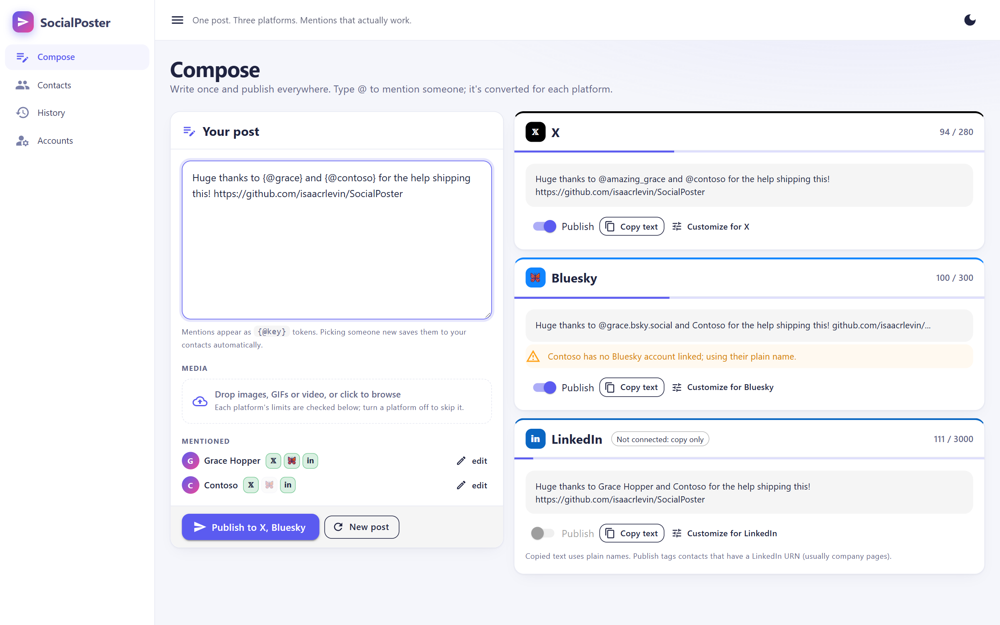

# SocialPoster

Write one post and publish it to **X**, **Bluesky** and **LinkedIn**, with mentions converted correctly for each platform.

A local Blazor Server app (.NET 10) with SQLite storage and a [MudBlazor](https://mudblazor.com) UI (light and dark themes, toggle in the top bar).



<details>
<summary>More screenshots</summary>

| | |
|---|---|
|  |  |
|  |  |
|  | |

</details>

📖 **Setup guide:** https://isaacrlevin.github.io/SocialPoster/

## How it works

You write a single post and type `@` to find people. A mention is stored as a platform-neutral token like `{@pfrazee}`. It points to a **contact**, which holds that person's identity on each platform:

| Platform | What's posted | Needs |
|---|---|---|
| X | `@pfrazee` | X username |
| Bluesky | `@pfrazee.com`, plus a mention facet (DID and byte offsets) so the tag is real | Handle / DID |
| LinkedIn | `@[Paul Frazee](urn:li:person:…)` in the Posts API commentary | Exact LinkedIn name + URN |

If a contact has no account on a platform, their plain name is used and the preview shows a warning. Each platform has a live preview with a character counter. You can also override the text for any platform.

- **X** weights each character (emoji/CJK count as 2) and every URL counts as a fixed 23 characters, matching X's `t.co` link wrapping.
- **Bluesky** shortens any `http(s)://` link the same way the official app does — to the domain plus the start of the path, e.g. `www.tiktok.com/@isaacrlevin...` — so the character count matches what you'd see there, while the full URL is still stored as the link's target (the facet) and works when clicked. If the post contains a link, publishing also attaches a link-preview card (title, description, thumbnail) the same way the official app does, by scraping the page's Open Graph tags; if that fails, the post still goes out with a plain link.

### Images, GIFs and video

Drop files onto the **Media** area under the post box (or click to browse). Each platform's limits are checked live in its preview card, and you can untick a platform to skip it. Add alt text to images for screen readers.

| Platform | Images | GIFs | Video |
|---|---|---|---|
| **LinkedIn** | Up to 20 (JPG/PNG, 10 MB each) | 1 (10 MB) | 1 (MP4, 75 KB-500 MB, 3 s-30 min) |
| **Bluesky** | Up to 4 (JPG/PNG/WebP, under 1 MB each) | Not supported by Bluesky | 1 (MP4/MOV/WebM, 100 MB, 3 min) |
| **X** (API posting) | Up to 4 (JPG/PNG/WebP, 5 MB each) | 1 (15 MB) | 1 (MP4/MOV, 512 MB) |

A post can contain images **or** one GIF **or** one video, not a mix. X's browser composer ("Post via browser instead") can't receive files, so attach media there by hand.

### Finding people

- **Bluesky:** search as you type. It's free and needs no login.
- **X:** exact username lookup: type `@username` and pick the 𝕏 item in the popup. Requires X API credentials, and each lookup counts against your X plan.
- **LinkedIn:** the API has no member search. Use the Copilot finder below to get their profile URL, or paste a URN you know. Organization URNs are the number in the company admin URL, e.g. `urn:li:organization:1035`.
- **Bio hints:** when you add a Bluesky contact, any X or LinkedIn links in their bio are picked up automatically.
- **Sync Bluesky follows** (Contacts page) imports everyone you follow. See [Importing your Bluesky contacts](#importing-your-bluesky-contacts).

Every person you pick is saved to Contacts automatically, so you only link their accounts once.

### Importing your Bluesky contacts

Rather than adding people one at a time, you can bring in everyone you follow on Bluesky:

1. Open **Accounts** and enter your Bluesky handle (an app password is only needed to publish, not to import).
2. Open **Contacts** and click **Sync Bluesky follows**. A running count is shown while it works.
3. When it finishes you'll see how many contacts were added and how many existing ones were refreshed. Running it again is safe: people are matched by their Bluesky account, not duplicated.

Each imported contact gets a template key, name, avatar and Bluesky handle. Any X or LinkedIn links in their bio are picked up automatically, and you can fill in the rest later (or let the Copilot finder do it). Large follow lists can take a minute.

### Managing contacts

The Contacts page lists everyone you've saved, with:

- **Filter box:** matches key, name, Bluesky handle, X username, or LinkedIn name.
- **Has X / Has LinkedIn:** narrow the list to contacts with (or without) an account linked on that platform.
- **Sort:** name (A–Z / Z–A), most used, recently used, or recently added.
- **Paging:** 25 contacts per page, with Prev/Next controls and a total count.

Clicking **Edit** on any row scrolls you back to the top of the page, where the editor opens.

### Copilot account finder (X and LinkedIn)

A GitHub Copilot agent (via the GitHub Copilot SDK) searches the web for someone's X and LinkedIn accounts and suggests matches for you to pick from.

- **On demand:** choose **✨ Find "name" with Copilot** in the `@` popup (useful for people who aren't on Bluesky). You can also click **✨ find accounts** next to a mentioned contact, or use the panel in the contact editor. **Refine** lets you add a full name or hints (company, role).
- **Automatic:** when you mention a contact with no X or LinkedIn account, a search runs in the background once. Turn this off in Settings.
- **Picking:** each suggestion shows a confidence score, the reason it matched, and a profile link, so check it before clicking **Use**. Your choices and the results are cached, so each person is searched only once.
- **LinkedIn people:** only the profile URL can be found, because the API can't tag members without partner access. After publishing, if anyone needs a manual tag, the post opens in a new browser tab automatically (your browser may block this pop-up; if so, use the **View post** link instead) and a **Tag by hand** checklist lists each person with a **Copy @name** button and their profile link. Company pages found with a numeric ID are tagged automatically.
- **Setup:** it uses the account you signed into with `copilot login` (the app reads the CLI's saved token from Windows Credential Manager), or a `GH_TOKEN`/`GITHUB_TOKEN` environment variable. If neither exists, paste a GitHub token in Settings → Copilot account finder. Click **Test connection** to check. The default model is `claude-haiku-4.5`: each search takes about 30–45 s and uses Copilot premium requests.

### Verifying accounts (Copilot)

X's lookup API costs a request each time, and LinkedIn has no lookup at all for other members. The **✨ Verify** buttons in the contact editor instead ask the same Copilot agent to check, via web search, whether a specific X handle or LinkedIn profile URL is real and currently active, and report back the exact name it found. It's slower than a direct API call (a web search, not a database check) but works without X credentials and is the only way to check a LinkedIn profile at all. Confirm the result against the profile link before relying on it.

## Getting started

### Prerequisites

- [.NET 10 SDK](https://dotnet.microsoft.com/download/dotnet/10.0)
- Git
- Optional: the [GitHub Copilot CLI](https://docs.github.com/copilot/how-tos/set-up/install-copilot-cli) (or a GitHub token) for the account finder. Nothing else is required to try the app: Bluesky search and "Copy text" work without any account.

### Run it

```bash
git clone https://github.com/isaacrlevin/SocialPoster.git
cd SocialPoster/src/SocialPoster.Web
dotnet run --launch-profile http    # http://localhost:5184
```

Works on Windows, Linux and macOS. The database is created automatically on first run; there is no migration or setup step. Then open **Settings** to connect the accounts you want to post to (see [Connecting accounts](#connecting-accounts)).

Run the tests from the `src` folder with `dotnet test`.

### Configuration

There are no API keys to put in config files. Credentials are entered in the app's **Settings** page and stored locally. The only config option is the data folder:

| Setting | Default | Notes |
|---|---|---|
| `SocialPoster:DataDirectory` (env: `SocialPoster__DataDirectory`) | `%LOCALAPPDATA%\SocialPoster` on Windows, `~/.local/share/SocialPoster` on Linux, `~/Library/Application Support/SocialPoster` on macOS | Holds `socialposter.db` (SQLite) and `keys/` (Data Protection key ring) |

To change the port, set `ASPNETCORE_URLS` (for example `ASPNETCORE_URLS=http://localhost:8080 dotnet run`) or edit `Properties/launchSettings.json`.

### Security notes

- **Local use only.** The app has no login. Anyone who can reach it can post as you, so keep it bound to `localhost` and don't expose it to a network or the internet.
- Credentials (app passwords, X keys, LinkedIn token, GitHub token) are stored in the local SQLite database, encrypted with ASP.NET Core Data Protection. On Windows the key ring is protected with DPAPI. On Linux and macOS there is no OS-level key protection, so the keys rely on owner-only file permissions (the app sets the data folder to `700`). Treat the data folder like you would an SSH key.
- Back up or delete the whole data folder together: the database can't be decrypted without `keys/`, so after losing it you'll need to re-enter your credentials.
- Use a Bluesky **app password**, never your main password.
- Reading the Copilot CLI's saved login from the OS credential store is only implemented on Windows. On Linux/macOS set `GH_TOKEN` or `GITHUB_TOKEN`, or paste a token in Settings.

## Connecting accounts

**Bluesky**
1. Go to Settings → Privacy and security → App passwords and create one.
2. Enter your handle and the app password.
3. Set a custom PDS under *Advanced* if you don't use `bsky.social`.

**X**
1. Create a project and app at developer.x.com.
2. Set app permissions to **Read and write**.
3. Generate an **Access Token and Secret** for your account. Do this after setting permissions, or the tokens will be read-only.
4. Enter the API key/secret and access token/secret. The app uses OAuth 1.0a user context.

Free X API tiers don't allow posting. If you don't have a paid tier, turn on **Post via browser instead** in the X card: publishing then opens `x.com/intent/post` in a new tab with your text pre-filled, and you click **Post** yourself — no API call, no credentials required. X credentials are still useful for the ✨ Verify button in the contact editor, which uses the API's username lookup directly instead of the Copilot agent.

**LinkedIn**

LinkedIn has no "paste your password" option for apps, so you create a small developer app and generate an access token for yourself. This is free and takes about five minutes. (LinkedIn occasionally renames things in its portal, so labels may differ slightly.)

1. Go to the [LinkedIn Developer Portal](https://www.linkedin.com/developers/apps) and click **Create app**.
2. Give it a name (for example "SocialPoster"), pick a **LinkedIn Page** to associate it with (create a free placeholder page if you don't have one), upload any logo, accept the terms and click **Create app**. If LinkedIn asks you to verify the app against the page, use the **Settings → Verify** link and have a page admin (you, usually) approve it.
3. Open the **Products** tab and request access to both of these. They're self-serve and normally approved immediately:
   - **Share on LinkedIn** (grants `w_member_social`, needed to post)
   - **Sign In with LinkedIn using OpenID Connect** (grants `openid` and `profile`, used to find out who you are)
4. Open the [OAuth token generator](https://www.linkedin.com/developers/tools/oauth/token-generation), choose your app, tick the scopes **`openid`**, **`profile`** and **`w_member_social`**, and click **Request access token**. Sign in and allow access.
5. Copy the access token. It's a long string starting with `AQ`.
6. In SocialPoster open **Accounts → LinkedIn**, paste it into **Access token** and click **Save**. The app checks it against LinkedIn and shows "Connected as *your name*". **Verify token** re-checks it later.
7. If LinkedIn rejects posts with a version error, change the **API version** value (format `YYYYMM`) to a more recent month.

LinkedIn access tokens expire after about **60 days**. When posting starts failing with an authorization error, repeat steps 4-6 to generate a fresh token. If you'd rather run the standard OAuth flow yourself (add `http://localhost` as a redirect URL under the **Auth** tab and exchange the code for a token), any token with the same scopes works.

SocialPoster uses the supplied token as-is and never requests or revokes one. **Forget token** only removes the locally stored copy; it does not invalidate the token at LinkedIn. LinkedIn's normal token expiration still applies.

"Copy text" works without any accounts connected. LinkedIn's copied text uses plain names, because tags only work through the API.

## Limitations

- No threads or scheduling. Media is limited to what each platform accepts (see [Images, GIFs and video](#images-gifs-and-video)); Bluesky doesn't support GIFs.
- LinkedIn people can't be tagged automatically unless you know their URN. The Copilot finder gets their profile URL, and you tag them by hand after posting. Organization vanity lookup requires Community Management API access.
- X lookups and posts cost money depending on your X API tier, unless you use the browser intent-post option, which is free but requires you to click Post yourself.
- Posting to a LinkedIn company page isn't supported; posts go from your personal account.

## Contributing

Issues and pull requests are welcome. Please run `dotnet build` and `dotnet test` from the `src` folder before submitting (CI runs both on Linux and Windows). Keep platform-independent logic in `SocialPoster.Core` with unit tests.

The setup guide site lives in `docs/` (screenshots come from `img/`) and is deployed by `.github/workflows/pages.yml`. To enable it on a fork, go to **Settings → Pages** and set **Source** to **GitHub Actions**. Preview locally by copying `img/` into a copy of `docs/` and opening `index.html`.

## License

[MIT](LICENSE)

## Layout

- `src/SocialPoster.Core`: template parsing, per-platform rendering, text metrics, OAuth1 signing (no dependencies, unit tested).
- `src/SocialPoster.Web`: Blazor UI, EF Core/SQLite, API clients.
- `src/SocialPoster.Tests`: xUnit tests.
