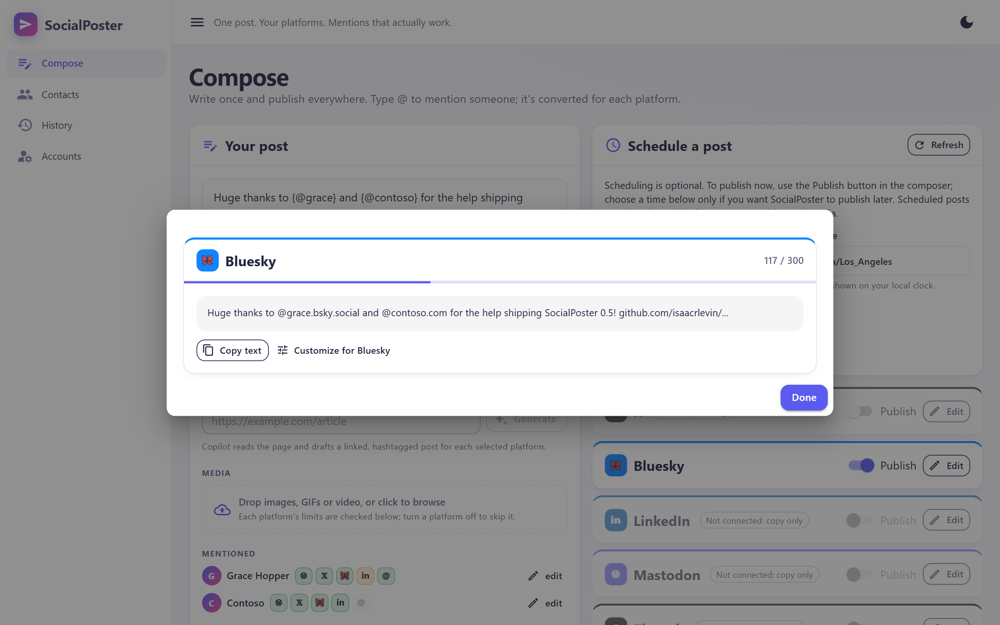
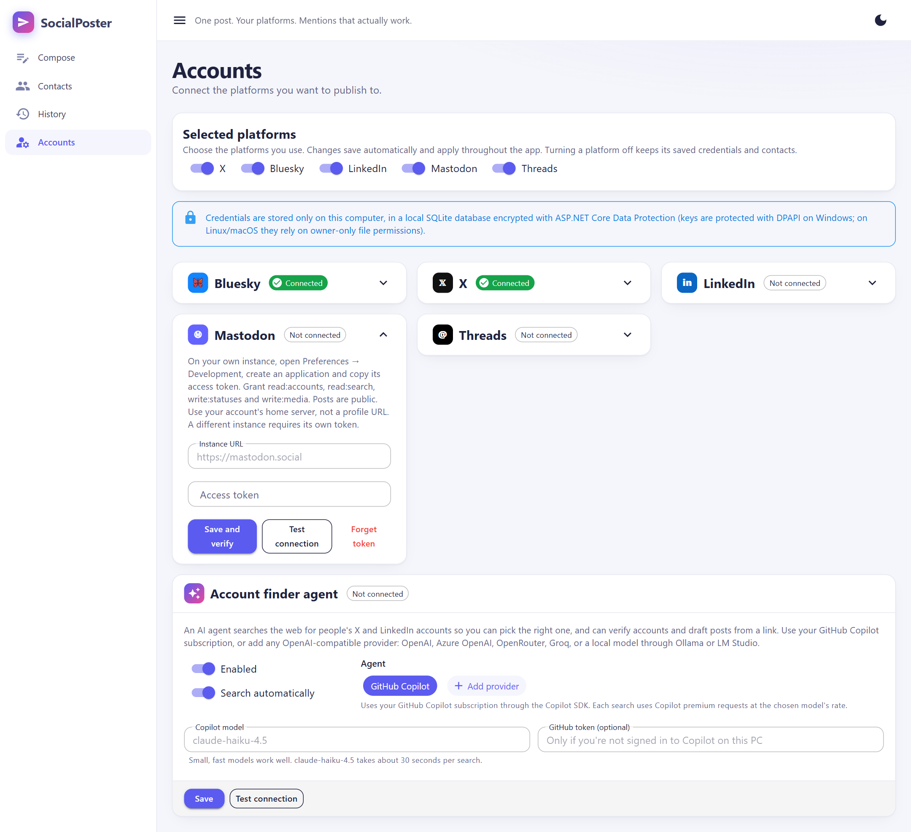
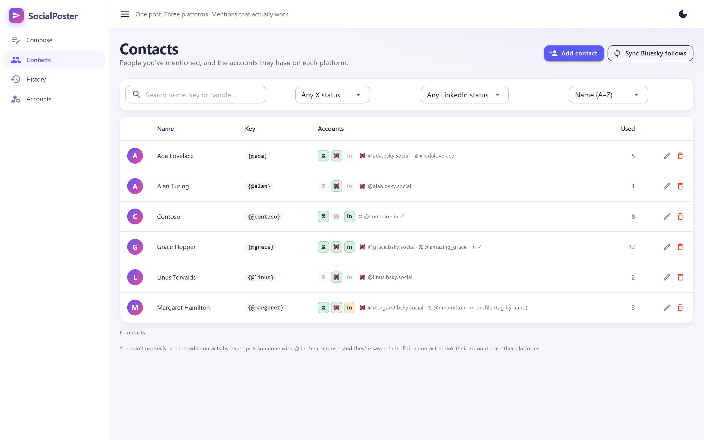
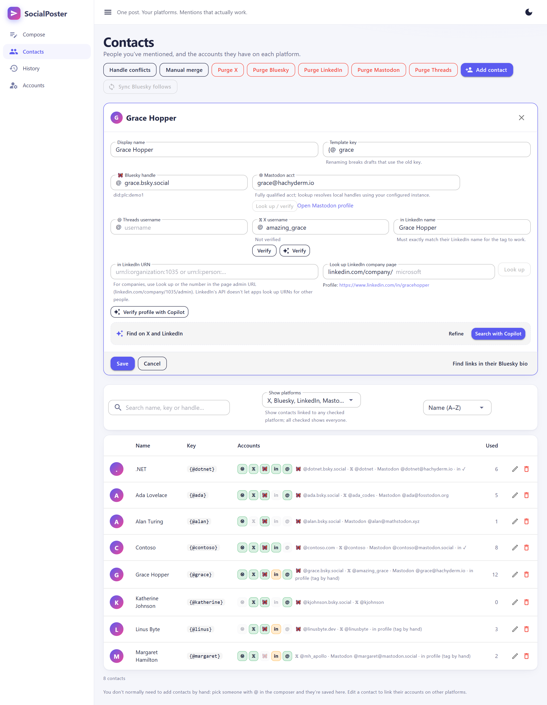
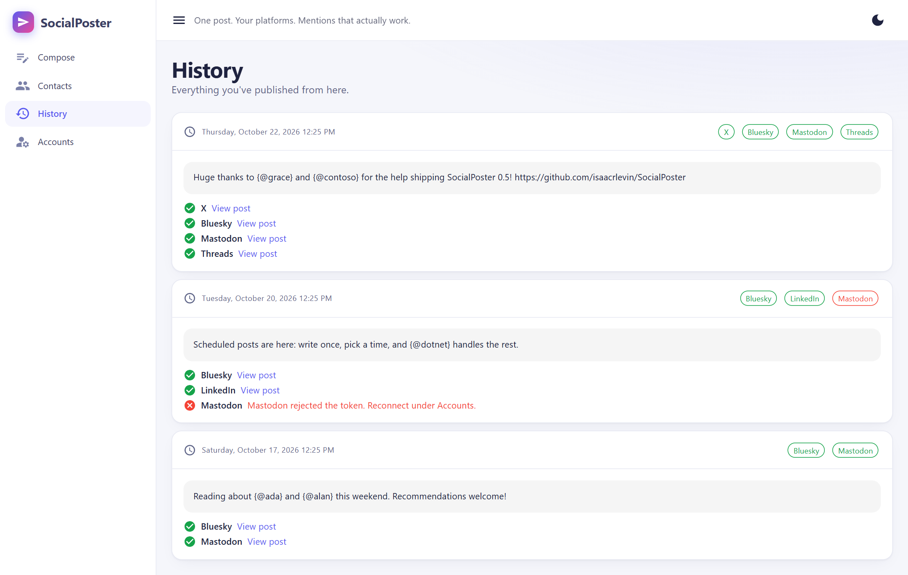
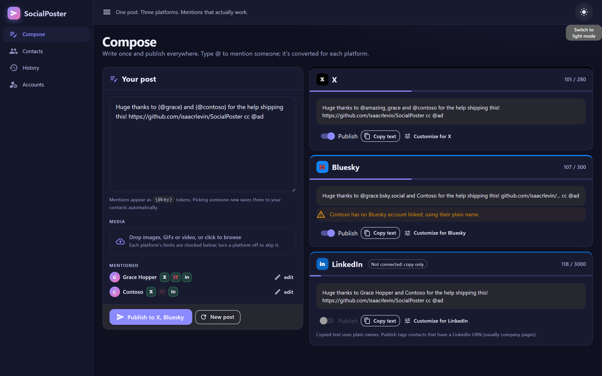

# SocialPoster

Write one post and publish it to **X**, **Bluesky**, **LinkedIn**, **Mastodon** and **Threads**, with mentions converted correctly
for each platform.

A reusable .NET 10 backend and Blazor Razor Class Library with SQLite storage and a [MudBlazor](https://mudblazor.com)
UI (light and dark themes, toggle in the top bar). The included Web project is a thin, local single-user sample host.
Posts can go out now or be scheduled for later, and an optional AI agent (GitHub Copilot or any OpenAI-compatible
provider) finds people's accounts and drafts posts from a link.

**Just want to post?** The posting engine is its own package, [`SocialPoster.Posting`](src/SocialPoster.Posting/README.md):
publish to all five platforms from any .NET app with no database, UI or ASP.NET. `SocialPoster.Core` and the Blazor
components build on it.

| Package                                                     | What it is                                                         |
|-------------------------------------------------------------|--------------------------------------------------------------------|
| [`SocialPoster.Posting`](src/SocialPoster.Posting/README.md) | Platform clients, rendering, character counting and media rules   |
| `SocialPoster.Core`                                         | SQLite storage, contacts, history, scheduling and the account finder |
| `SocialPoster.Components`                                   | The Blazor UI (pages, layout, theme and assets)                    |


<details>
<summary>More screenshots</summary>

|                                                    |                                         |
|----------------------------------------------------|-----------------------------------------|
|         |            |
|                       |  |
|                         |       |

</details>

📖 **Setup guide:** https://isaacrlevin.github.io/SocialPoster/

## How it works

You write a single post and type `@` to find people. A mention is stored as a platform-neutral token like `{@pfrazee}`.
It points to a **contact**, which holds that person's identity on each platform:

| Platform | What's posted                                                                  | Needs                     |
|----------|--------------------------------------------------------------------------------|---------------------------|
| X        | `@pfrazee`                                                                     | X username                |
| Bluesky  | `@pfrazee.com`, plus a mention facet (DID and byte offsets) so the tag is real | Handle / DID              |
| LinkedIn | `@[Paul Frazee](urn:li:person:…)` in the Posts API commentary                  | Exact LinkedIn name + URN |
| Mastodon | `@user@server` (including accounts local to your instance)                     | Fully qualified acct      |
| Threads  | `@username`                                                                    | Threads username          |

If a contact has no account on a platform, their plain name is used and the preview shows a warning. Each platform has a
card under the scheduling panel: switch **Publish** on or off for that platform, and click **Edit** to open its live
preview with a character counter, warnings, **Copy text** and **Customize for ...** to override the text for that
platform only. Platforms that aren't connected are marked *copy only*.

To draft from an article or other public page, enter its URL in **Draft from a link** and choose **Generate**. The
account finder agent (Copilot or your own provider, see [below](#choosing-the-agent-copilot-or-your-own-provider))
reads the page and creates shared text plus a linked, hashtagged customized draft for each connected platform
selected for publishing. Each customized draft appears in that platform's editor; use **Use shared text** or
**Customize** to switch versions, and review the character counts before publishing.

### Scheduling posts

Scheduling is optional: use **Publish to ...** in the composer to publish now, or choose a local date and time in the
**Schedule a post** panel and click **Schedule selected platforms** to publish later. Scheduled posts use the selected
platforms, text overrides and media.

- **Frozen at scheduling time.** Mentions are resolved and each platform's text is rendered and validated when you
  schedule; media files are copied to `scheduled-media/` in the data directory. Credentials are never stored with the
  schedule; they are read when the post goes out.
- **Time zones.** Enter the time as shown on your local clock and pick the time zone (it defaults to the browser's).
  Times skipped by a daylight-saving change are rejected, and times that occur twice ask you to choose a UTC offset.
- **Managing schedules.** **Scheduled posts (n)** lists every schedule with per-platform outcomes and **View post**
  links. Until delivery starts you can **Edit content** (loads it back into the composer), **Reschedule** or
  **Cancel schedule**.
- **Delivery.** The app's scheduling worker polls every 15 seconds, so it must be running around the due time and the
  data directory must remain available. A post that is more than 24 hours overdue (for example because the app was
  closed) expires instead of publishing unexpectedly. HTTP 429 rate limits are retried up to 3 times; other rejections
  fail. A timeout or lost response is marked **uncertain** and not retried, because the platform may already have
  accepted the post. Check the platform before posting again.
- X's browser-intent mode can't be scheduled because it requires you to finish publishing yourself. Deselect X to
  schedule the other platforms.

- **X** weights each character (emoji/CJK count as 2) and every URL counts as a fixed 23 characters, matching X's `t.co`
  link wrapping.
- **Mastodon** counts Unicode graphemes, URLs as 23 characters, and qualified mentions as their local `@username`. URL
  detection covers HTTP(S) and common bare-domain links, without counting emails or mention domains as links; unusual
  URL syntax may differ from the server's parser. Previews, overrides, copying, publishing and history use the same
  workflows as other platforms. The app uses conservative defaults: 500 characters, up to four 8 MB JPG/PNG/WebP images,
  one 8 MB GIF, or one 40 MB MP4/WebM video (no mixed media). Server limits may differ; limits are not dynamically
  discovered. Server-side validation errors are shown.
- **Threads** counts Unicode graphemes against a 500-character limit and posts publicly through the Threads Graph API.
  Connect it under Accounts with a user access token that has `threads_basic` and `threads_content_publish`. Posts are
  **text only**: the API accepts media only by public URL, not uploads, so selecting Threads with attachments shows a
  validation error. Contacts store a Threads username (add it by hand; follow sync isn't supported).
- **Bluesky** shortens any `http(s)://` link the same way the official app does — to the domain plus the start of the
  path, e.g. `www.tiktok.com/@isaacrlevin...` — so the character count matches what you'd see there, while the full URL
  is still stored as the link's target (the facet) and works when clicked. If the post contains a link, publishing also
  attaches a link-preview card (title, description, thumbnail) the same way the official app does, by scraping the
  page's Open Graph tags; if that fails, the post still goes out with a plain link.

### Images, GIFs and video

Drop files onto the **Media** area under the post box (or click to browse). Each platform's limits are checked live in
its preview card, and you can untick a platform to skip it. Add alt text to images for screen readers.

| Platform            | Images                                  | GIFs                     | Video                             |
|---------------------|-----------------------------------------|--------------------------|-----------------------------------|
| **LinkedIn**        | Up to 20 (JPG/PNG, 10 MB each)          | 1 (10 MB)                | 1 (MP4, 75 KB-500 MB, 3 s-30 min) |
| **Bluesky**         | Up to 4 (JPG/PNG/WebP, under 1 MB each) | Not supported by Bluesky | 1 (MP4/MOV/WebM, 100 MB, 3 min)   |
| **X** (API posting) | Up to 4 (JPG/PNG/WebP, 5 MB each)       | 1 (15 MB)                | 1 (MP4/MOV, 512 MB)               |
| **Mastodon**        | Up to 4 (JPG/PNG/WebP, 8 MB each)       | 1 (8 MB)                 | 1 (MP4/WebM, 40 MB)               |
| **Threads**         | Not supported (text only)               | Not supported            | Not supported                     |

A post can contain images **or** one GIF **or** one video, not a mix. X's browser composer ("Post via browser instead")
can't receive files, so attach media there by hand.

### Finding people

- **Bluesky:** search as you type. It's free and needs no login.
- **Mastodon:** connected-instance account search as you type; exact acct lookup/verification in Contacts. Local API
  accts are qualified with the canonical actor domain (including when the instance uses a different web domain).
  Contacts use canonical ActivityPub actor URIs as stable identity, not instance-local numeric IDs.
- **X:** exact username lookup: type `@username` and pick the 𝕏 item in the popup. Requires X API credentials, and each
  lookup counts against your X plan.
- **LinkedIn:** the API has no member search. Use the Copilot finder below to get their profile URL, or paste a URN you
  know. Organization URNs are the number in the company admin URL, e.g. `urn:li:organization:1035`.
- **Bio hints:** when you add a Bluesky contact, any X or LinkedIn links in their bio are picked up automatically.
- **Sync Bluesky follows** (Contacts page) imports everyone you follow.
  See [Importing your Bluesky contacts](#importing-your-bluesky-contacts).
- **Sync X follows** is available when X is enabled, all four X API credentials are configured, and **Post via browser
  instead** is off.
- **Sync Mastodon follows** imports the connected account's following list, with pagination, progress and the same
  stable-identity/conflict safeguards. Disabling Mastodon hides its workflows without deleting credentials or contacts.

Every person you pick is saved to Contacts automatically, so you only link their accounts once.

### Importing your Bluesky contacts

Rather than adding people one at a time, you can bring in everyone you follow on Bluesky:

1. Open **Accounts** and enter your Bluesky handle (an app password is only needed to publish, not to import).
2. Open **Contacts** and click **Sync Bluesky follows**. A running count is shown while it works.
3. When it finishes you'll see how many contacts were added and how many existing ones were refreshed. Running it again
   is safe: people are matched by their Bluesky account, not duplicated.

Each imported contact gets a template key, name, avatar and Bluesky handle. Any X or LinkedIn links in their bio are
picked up automatically, and you can fill in the rest later (or let the Copilot finder do it). Large follow lists can
take a minute.

### Importing your X contacts

Enable X under **Accounts**, configure all four API credentials, and turn off **Post via browser instead**. On
**Contacts**, click **Sync X follows**. The importer resolves the account belonging to your access token and paginates
through its following list, showing a running count. It uses your X API quota and requires a plan/permissions that allow
reading follows; authentication, permission, and rate-limit errors are shown rather than treated as an empty list. No
import is available in browser-only mode, even if credentials are saved.

### Connecting Mastodon and importing follows

1. Enable **Mastodon** under Accounts. On your home instance, open **Preferences → Development**, create an application
   and copy its access token. Grant `read:accounts`, `read:search`, `write:statuses` and `write:media`.
2. Enter the instance's HTTPS origin (for example `https://mastodon.social`, not a profile URL) and token. **Save and
   verify** checks `/api/v1/accounts/verify_credentials` before storing the pair, encrypted at rest. Blank token retains
   it only for the same instance. **Test connection** verifies persisted credentials; **Forget token** removes it
   locally, without revoking it on the server.
3. Compose, select Mastodon, review/copy the preview or platform override, and publish. Statuses are **public**. Upload
   descriptions use alt text (up to 1000 characters); the client waits for asynchronous media processing before creating
   the status. Failed uploads/processing prevent posting, and authentication/permission/rate-limit errors appear with
   reconnect guidance. Uploaded media may remain on the server if a later step fails.
4. On Contacts, use **Sync Mastodon follows**, or add `user@server` manually. **Look up / verify** accepts a local
   username and qualifies it via your connected instance. Profile URLs and explicit `@user@server` bio hints participate
   in imports, filtering, badges, conflict suggestions, whole-identity merges and purge. Existing databases receive
   nullable Mastodon columns automatically without changing older identities or platform enum values.

Mastodon **4.2 or newer** is required for the account actor URI field. Search/lookup requires a connected account and
depends on what that server can resolve. Exact lookup falls back to resolving account search when the instance does not
yet know a remote account; unrelated search results are never selected. Media polling handles empty HTTP 206 responses
as still processing. HTTPS origins are required. Copilot discovery remains limited to X and LinkedIn. OAuth
authorization, token generation/refresh, visibility selection and dynamic instance limits are not provided. Fully
qualified acct matches and canonical actor URIs are used for imports; account migrations to a new actor URI are not
inferred from display names.

All three follow imports attempt to reuse saved contacts: stable platform IDs first, then case-insensitive handles, then
explicit profile links/bio hints (including expanded X links). Display names and similar-looking handles across
platforms are **not** evidence of a match. Saved template keys, other identities, edited names/bios/avatars, and
usage/history are preserved; missing metadata can be filled in. With **Sync without handling**, ambiguous matches are
skipped, conflicting bio links are not applied, and completion counts identify accounts needing manual review. Imports
do not collapse multiple existing contact rows. If an API error interrupts an import, completed accounts remain saved;
retrying does not duplicate uniquely matched accounts.

Before any Bluesky, X or Mastodon follow sync, the **Handle Duplicates** prompt offers **Yes, review**, **Sync without
handling**, or **Cancel** (no import requests). Close an open contact editor before syncing. Opting in pauses the sync
before saving an incoming account with conflicting/ambiguous evidence or a probable normalized-name match. Names only
flag candidates; they never cause automatic merging. Choose a saved contact and review it with the existing manual merge
experience, explicitly resolve each whole-platform identity collision, and confirm that these are the same contact. The
saved contact retains its key, aliases, edited metadata, source, creation time, usage and history; its discovery
revision advances and bound discovery caches are invalidated. No incoming row or key exists before the decision.

You can instead **Keep separate**, **Skip account**, or **Cancel sync**. Keeping separate or merging cannot take an
identity owned by another saved contact. If multiple saved rows own the proposed identities, skip the account and merge
those saved rows separately first, or choose identities that do not collide. Ambiguous bio links are never applied
automatically. Changes to contacts while a review is open reject the decision and require a fresh sync preview; no
database transaction is held while waiting for review or network requests. Cancellation/navigation stops remaining work
and dismisses the sync dialog, while previously completed imports stay saved. Progress advances only after an account is
saved or skipped, and success is reported only after all reviews finish. Unchanged uniquely matched primary identities
do not prompt again on retries.

Library consumers can opt in with the optional `ContactImportReviewer` callback on any `Sync*FollowsAsync` method (also
on resolved-account import methods). Without a callback, the existing safe import behavior is unchanged. Return a
confirmed `ContactImportDecision` for a reviewed candidate, using its saved ID or `-1` (transient incoming account) for
every collision choice; or return keep-separate, skip or cancel. Observe the supplied cancellation token. Reviewed saves
recheck the snapshot and current identity ownership transactionally; stale or invalid decisions fail without saving that
account.

For legacy contacts with a saved handle but no platform ID, a matching display name
prompts an API lookup of the saved handle to check for a rename. Only a matching
stable ID allows linking the new handle; names alone never merge people. An old
handle that cannot be verified is flagged as a possible duplicate and skipped
instead of creating another contact. These verification lookups use API requests (including X quota). Stored profile
URLs and `@` prefixes are normalized for
matching, and each identity check/save runs in a transaction so simultaneous
imports cannot create duplicate rows for the same account.

### Managing contacts

The Contacts page lists everyone you've saved, with:

- **Filter box:** matches key, name, Bluesky handle, X username, Mastodon acct, or LinkedIn name.
- **Show platforms:** one checkbox dropdown containing enabled platforms. All are checked initially to show everyone,
  including contacts without linked accounts. Check a subset to show contacts linked to any checked platform (including
  LinkedIn profile-only accounts); uncheck all to hide all contacts. This filters the Contacts list only and does not
  change the platforms enabled under Accounts.
- **Sort:** name (A–Z / Z–A), most used, recently used, or recently added.
- **Paging:** 25 contacts per page, with Prev/Next controls and a total count.

Clicking **Edit** on any row scrolls you back to the top of the page, where the editor opens.

#### Contact maintenance

- **Purge X / Purge Bluesky / Purge LinkedIn / Purge Mastodon / Purge Threads** appears only for enabled platforms. The confirmation
  describes a global operation across **all contacts/accounts**, regardless of list
  filters: it removes that platform's handles, profile URLs, names, stable IDs/URNs, verification timestamps
  and cached discovery candidates. Contacts with no remaining accounts are deleted,
  together with their aliases and searches; their mentions become unknown. Contacts
  with any other account (even on a disabled platform) and published history are preserved.
  Saving a contact with no accounts also removes it; a new accountless manual contact
  is not saved. Name-only contacts temporarily created for Copilot linking remain
  available for that workflow. Affected contact counts are shown;
  confirmation is required even when only cached candidates exist. In-flight
  discovery results and stale editor saves cannot restore pre-purge identities.
- **Handle conflicts** warns before starting that large contact lists may take time,
  then shows a progress bar and completed comparison count while scanning. Scans run
  only when requested, never automatically after a merge. Merging removes suggestions
  involving either merged contact; other suggestions remain until dismissed or rescanned.
  Completed suggestions are automatically saved in the local database and restored
  after navigation or reload without scanning again. Restored suggestions use current
  contact details and omit deleted contacts; they still reflect the last requested scan.
  Dismissing suggestions clears the saved results. Saved scans are shared by users
  of the same SocialPoster database.
  It suggests pairs based on normalized platform identities,
  explicit profile links in bios, or similar normalized names. Names are only a
  review aid, not proof of identity. There are no network verification calls or
  automatic merges. Review both contacts, choose the **survivor**, and explicitly
  select which *whole identity* to keep for every incompatible platform (including
  disabled platforms, to avoid silently discarding their data). Then confirm.
- **Manual merge** lets you select exactly two contacts using list checkboxes,
  including contacts on different pages or found through different filters. Click **Review selected merge** to use the
  same survivor, identity-resolution and
  confirmation workflow without running a scan. Cancel manual merge to clear the selection.
- A merge is transactional. The survivor keeps its key, edited metadata (even
  deliberately blank fields), source and creation time. Complementary identities
  are combined, use counts summed, and the latest usage time retained. Old source
  keys and earlier merge aliases are reserved and resolve directly to the survivor:
  existing `{@key}` mentions in templates, history and browser-local drafts continue
  to work, without rewriting arbitrary text or historical publish results. Repeated
  aliases in one post count as one use. Contact-bound discovery caches move to the
  survivor; colliding, incompatible or running caches are explicitly invalidated.
  A changed preview must be reopened; invalid merges leave both contacts intact.

Maintenance cannot be undone. Purge is not a permanent blocklist: later explicit
imports, searches, edits or bio refreshes can link identities again. Reload any
already-open composer in another tab to refresh its in-memory preview/candidates
after maintenance; publishing resolves keys from the database. Browser draft text
is left unchanged, and old merged keys cannot be reused for a different person.
Deleting the final survivor removes its aliases; as with ordinary contact deletion,
those mentions then become unknown. Manual key renaming still breaks mentions of
the renamed primary key; merge aliases remain attached to the contact ID.

### Account finder agent (X and LinkedIn)

An AI agent searches the web for someone's X and LinkedIn accounts and suggests
matches for you to pick from.

- **On demand:** choose **✨ Find "name" with Copilot** in the `@` popup (useful for people who aren't on Bluesky). You
  can also click **✨ find accounts** next to a mentioned contact, or use the panel in the contact editor. **Refine**
  lets you add a full name or hints (company, role).
- **Automatic:** when you mention a contact with no X or LinkedIn account, a search runs in the background once. Turn
  this off with **Search automatically** under Accounts → Account finder agent.
- **Picking:** each suggestion shows a confidence score, the reason it matched, and a profile link, so check it before
  clicking **Use**. Your choices and the results are cached, so each person is searched only once.
- **LinkedIn people:** only the profile URL can be found, because the API can't tag members without partner access.
  After publishing, if anyone needs a manual tag, the post opens in a new browser tab automatically (your browser may
  block this pop-up; if so, use the **View post** link instead) and a **Tag by hand** checklist lists each person with a
  **Copy @name** button and their profile link. Company pages found with a numeric ID are tagged automatically.
- **Setup:** it uses the account you signed into with `copilot login` (the app reads the CLI's saved token from Windows
  Credential Manager), or a `GH_TOKEN`/`GITHUB_TOKEN` environment variable. If neither exists, paste a GitHub token in
  Accounts → Account finder agent. Click **Test connection** to check. The default model is `claude-haiku-4.5`: each
  search takes about 30–45 s and uses Copilot premium requests. To avoid Copilot entirely, add your own provider
  (next section). [Setting up the agent's accounts](#setting-up-the-agents-accounts) lists the tokens, permissions and
  keys each option needs.

#### Choosing the agent: Copilot or your own provider

Under Accounts → **Account finder agent**, pick the agent from the chips: **GitHub Copilot** (the default) or any
provider you add with **Add provider**. A provider is any server that speaks the OpenAI chat completions API, so one form
covers OpenAI, Microsoft Foundry (endpoint, key and deployment name), OpenRouter, Groq,
and local models through Ollama (`http://localhost:11434/v1`) or LM Studio. Presets fill in the base URL; you enter the
model and, for hosted services, an API key. **Test** sends a one-word request (and one search) to check everything before
you save. You can save several providers and switch between them. API keys are stored encrypted like other credentials
and are only sent to that provider's base URL; plain `http://` is accepted only for this computer or your local network.

Models from these providers can't browse the web, so the agent is given two tools:

- **`web_search`**, backed by a search service you choose under **Web search**: [Brave Search](https://brave.com/search/api/)
  or [Tavily](https://tavily.com) (API key, both include free monthly usage), or your own [SearXNG](https://docs.searxng.org)
  instance (free, no key; enable `json` in its `search.formats`). Copilot has its own search and ignores this setting.
- **`web_fetch`**, a built-in page reader that refuses localhost, private/link-local addresses (including cloud metadata
  endpoints), non-web ports and credentials in URLs, re-checks every redirect, ignores system proxies, and caps response
  size. Page text and search results are treated as untrusted: the agent is told never to follow instructions found in
  them, and each job is limited to 10 tool calls.

Choose a model that supports **tool calling**. Small local models often don't, or loop; if results are poor, try a larger
model. Account **verification** relies on reading the profile page itself, and X and LinkedIn often show logged-out
visitors a login wall instead of the profile, which the agent reports as inconclusive. Copilot's own fetcher gets through
more often, so expect better verification results with Copilot.

#### Setting up the agent's accounts

Everything below is entered under Accounts → **Account finder agent**. **Test connection** (Copilot) or **Test**
(providers) checks the setup before you rely on it.

**GitHub Copilot**

- You need a GitHub account with an active **Copilot subscription**. Requests are billed to that subscription and
  count against its premium request allowance and rate limits. If your Copilot seat comes from an organization or
  enterprise, its policies (IP allow lists, SAML SSO, which models are enabled) still apply.
- SocialPoster uses the first token it finds: the **GitHub token** saved in the card, then `GH_TOKEN`, then
  `GITHUB_TOKEN`, then (Windows only) the Copilot CLI's saved `copilot login`. A token in the card or environment
  replaces the CLI login, so an unsuitable `GH_TOKEN` breaks the agent even if `copilot login` works.
- Supported tokens are OAuth tokens from `copilot login` or `gh auth login` (`gho_`), GitHub App user tokens
  (`ghu_`) and **fine-grained** personal access tokens (`github_pat_`). **Classic tokens (`ghp_`) don't work.**
- To create a fine-grained token: open [Fine-grained tokens](https://github.com/settings/personal-access-tokens/new),
  set **Resource owner** to your **personal account** (not an organization; the permission only exists on user-owned
  tokens), leave **Repository access** at *Public repositories*, and under **Permissions → Account** add
  **Copilot Requests**. No repository permissions are needed. Choose an expiration, generate the token, and paste it into
  **GitHub token (optional)**. If an organization uses SAML SSO, authorize the token for it.
- **Test connection** also lists the models your plan can use. Enter one of those in **Copilot model** if you don't want
  the default.

**Your own provider**

The agent only calls `/chat/completions` with tool definitions, so a key needs nothing more than chat completion access
to a model that supports **tool (function) calling**. SocialPoster sends the key as `Authorization: Bearer <key>`.

| Provider               | Where to get the key                                                                 | Notes |
|------------------------|--------------------------------------------------------------------------------------|-------|
| **OpenAI**             | [platform.openai.com/api-keys](https://platform.openai.com/api-keys)                  | The project needs billing or credits. For a *Restricted* key, set the top-level **Model capabilities** permission to *Request* (*Write* in older UI). Enabling only its *Chat completions* sub-item can leave out the `model.request` scope and fail with "Missing scopes". |
| **Microsoft Foundry**  | Your Foundry or Azure OpenAI resource's **Keys and Endpoint** page                   | Deploy a tool-capable chat model first, then enter just the **Endpoint**, **key** and **Deployment name**. Any endpoint the portal shows works (`https://<resource>.services.ai.azure.com`, `https://<resource>.openai.azure.com`, a project endpoint, or a deployment's target URI, which also fills in the deployment name); SocialPoster turns it into the resource's `/openai/v1` URL. Only API keys are supported, so key-based authentication must not be disabled on the resource; Microsoft Entra ID sign-in isn't available. |
| **OpenRouter**         | [openrouter.ai/keys](https://openrouter.ai/keys)                                      | Pick a model that lists *tools* support. Add credits, or use a free model (they're rate limited). You can set a credit limit on the key. |
| **Groq**               | [console.groq.com/keys](https://console.groq.com/keys)                                | Use a model Groq lists as supporting tool use. Free usage is rate limited. |
| **Ollama** (local)     | No key                                                                                | `ollama pull llama3.1` (or another tool-capable model such as `qwen2.5`) and keep Ollama running. On another PC on your network, start it with `OLLAMA_HOST=0.0.0.0` and use `http://<that-pc>:11434/v1`. |
| **LM Studio** (local)  | No key                                                                                | Load a tool-capable model and start the server on the **Developer** tab (default `http://localhost:1234/v1`). Turn on *Serve on Local Network* to use it from another PC. |
| **Custom**             | Whatever the server requires as a bearer token                                        | Any OpenAI-compatible `/chat/completions` endpoint. Leave the key blank if it needs none. |

Plain `http://` is only accepted for this computer or private network addresses, so hosted services must use HTTPS.

**Web search (needed for your own provider)**

- **Brave Search:** create an account at the [Brave Search API dashboard](https://api-dashboard.search.brave.com) (it's
  separate from any Brave browser account), activate the **Search** plan, then create a key under **API Keys**. Brave
  requires a card on file and includes a monthly free credit; usage beyond it is billed. SocialPoster sends the key as
  `X-Subscription-Token`.
- **Tavily:** sign up at [app.tavily.com](https://app.tavily.com) and copy the API key (`tvly-…`) from the overview
  page. The free plan includes 1,000 credits a month with no card required; SocialPoster uses basic search, which
  costs one credit per search.
- **SearXNG:** run your own instance (for example the official Docker image) and enter its URL, for example
  `http://localhost:8080`. In its `settings.yml`, add `json` to `search.formats` (for example
  `formats: [html, json]`) and restart. Otherwise every search returns 403. If the instance's limiter is on
  (`server.limiter: true`), it may also block SocialPoster as a bot; turn the limiter off for a private instance, or add
  this computer's IP to `pass_ip` in `limiter.toml`. Public instances usually disable JSON, so use your own.

### Verifying accounts with the agent

X's lookup API costs a request each time, and LinkedIn has no lookup at all for other members. The **✨ Verify** buttons
in the contact editor instead ask the selected agent to check, via web search, whether a specific X handle or
LinkedIn profile URL is real and currently active, and report back the exact name it found. It's slower than a direct
API call (a web search, not a database check) but works without X credentials and is the only way to check a LinkedIn
profile at all. Confirm the result against the profile link before relying on it.

## Getting started

### Prerequisites

- [.NET 10 SDK](https://dotnet.microsoft.com/download/dotnet/10.0)
- Git
- Optional: the [GitHub Copilot CLI](https://docs.github.com/copilot/how-tos/set-up/install-copilot-cli) (or a GitHub
  token), or an OpenAI-compatible provider such as a local Ollama model, for the account finder. Nothing else is
  required to try the app: Bluesky search and "Copy text" work without any account.

### Run it

```bash
git clone https://github.com/isaacrlevin/SocialPoster.git
cd SocialPoster/src/SocialPoster.Web
dotnet run --launch-profile http    # http://localhost:5184
```

Works on Windows, Linux and macOS. The database is created automatically on first run; there is no migration or setup
step. Then open **Accounts** to choose your platforms and connect the ones you want to post to
(see [Connecting accounts](#connecting-accounts)). The sample runs the scheduling worker, so scheduled posts go out
while it is running.

Run the tests from the `src` folder with `dotnet test`.

### Configuration

There are no API keys to put in config files. Credentials are entered in the app's **Accounts** page and stored locally.
The sample binds the `SocialPoster` configuration section to `SocialPosterOptions`:

| Setting                                                           | Default                                                                                                                                 | Notes                                                                   |
|-------------------------------------------------------------------|-----------------------------------------------------------------------------------------------------------------------------------------|-------------------------------------------------------------------------|
| `SocialPoster:DataDirectory` (env: `SocialPoster__DataDirectory`) | `%LOCALAPPDATA%\SocialPoster` on Windows, `~/.local/share/SocialPoster` on Linux, `~/Library/Application Support/SocialPoster` on macOS | Holds `socialposter.db` (SQLite) and `keys/` (Data Protection key ring) |
| `SocialPoster:DatabaseFileName`                                   | `socialposter.db`                                                                                                                       | File name inside the data directory; no directory separators            |
| `SocialPoster:PostingTimeout`                                     | `00:30:00`                                                                                                                              | HTTP timeout for platform clients, including media uploads              |

Scheduling options bind from `SocialPoster:Scheduling` (env: `SocialPoster__Scheduling__PollInterval` and so on):

| Setting           | Default    | Notes                                                                       |
|-------------------|------------|-----------------------------------------------------------------------------|
| `PollInterval`    | `00:00:15` | How often the worker looks for due posts                                    |
| `AttemptTimeout`  | `00:30:00` | Time limit for one delivery attempt                                         |
| `LeaseDuration`   | `00:35:00` | How long a worker owns a claimed post; must be longer than `AttemptTimeout` |
| `MaxLateness`     | `1.00:00:00` | Posts overdue by more than this expire instead of publishing            |
| `MaxAttempts`     | `3`        | HTTP 429 retries per platform (1–10)                                        |
| `RetryDelay`      | `00:05:00` | Base delay between retries, multiplied by the attempt number                |

To change the port, set `ASPNETCORE_URLS` (for example `ASPNETCORE_URLS=http://localhost:8080 dotnet run`) or edit
`Properties/launchSettings.json`.

## Embed SocialPoster in your own project

Three packable libraries contain the implementation, all published to NuGet with the same version:

- **SocialPoster.Posting**: platform clients (`BlueskyClient`, `XClient`, `LinkedInClient`, `MastodonClient`,
  `ThreadsClient`), `SocialPublisher`, post rendering, character counting, media rules and `ICredentialStore`. Needs
  only `Microsoft.Extensions.Http`/`Options`; no database, UI or ASP.NET. See its
  [own README](src/SocialPoster.Posting/README.md).
- **SocialPoster.Core**: `SocialPoster.Core.Data.AppDbContext`, encrypted settings (`SecretStore`, which is the
  `ICredentialStore`), contact/publishing services, optional scheduling, and the account finder agent. Depends on
  Posting and requires the ASP.NET Core shared framework, EF Core SQLite, Microsoft.Extensions.AI (OpenAI-compatible
  providers) and GitHub.Copilot.SDK; it has no UI or Web dependency.
- **SocialPoster.Components**: all pages, layouts, shared components, theme, scripts and static assets. Depends on Core
  and MudBlazor, never on the sample Web project. Requires **Blazor interactive server** hosting: SQLite, protected
  credentials and the agent run on the server, not in WebAssembly.

### Packages and backend registration

Pack locally (these commands do not publish anything):

```powershell
dotnet pack src/SocialPoster.Posting/SocialPoster.Posting.csproj -c Release -o artifacts/packages
dotnet pack src/SocialPoster.Core/SocialPoster.Core.csproj -c Release -o artifacts/packages
dotnet pack src/SocialPoster.Components/SocialPoster.Components.csproj -c Release -o artifacts/packages
```

Add `artifacts/packages` as a NuGet source for local testing, or run `scripts/publish-local.ps1` (see
[Releasing](#releasing)), which packs all three with a fresh prerelease version into a local feed. Core and Components
include this README; Posting includes its own; all include the MIT license. Their NuGet dependencies are transitive
(Components → Core → Posting); do not copy DLLs or use `PrivateAssets="all"` on the library references.

For example, a .NET 10 Blazor Web App named `MyHost` uses:

```xml
<Project Sdk="Microsoft.NET.Sdk.Web">
  <PropertyGroup>
    <TargetFramework>net10.0</TargetFramework>
    <Nullable>enable</Nullable>
    <ImplicitUsings>enable</ImplicitUsings>
  </PropertyGroup>
  <ItemGroup>
    <PackageReference Include="SocialPoster.Components" Version="0.5.1" />
  </ItemGroup>
</Project>
```

For backend-only use, reference `SocialPoster.Core` instead, or just `SocialPoster.Posting` to publish without any
storage. In a repository checkout, `ProjectReference` to the corresponding `.csproj` works identically.

`Program.cs` for a consumer with its own `MyHost.Components.App` document:

```csharp
using MyHost.Components;
using SocialPoster.Core;
using SocialPoster.Components;

var builder = WebApplication.CreateBuilder(args);
builder.Services.AddSocialPosterCore(options =>
{
    options.DataDirectory = Path.Combine(builder.Environment.ContentRootPath, "socialposter-data");
    options.DatabaseFileName = "socialposter.db";
    options.PostingTimeout = TimeSpan.FromMinutes(30);
});
builder.Services.AddSocialPosterScheduling();       // optional: scheduled posts
builder.Services.AddSocialPosterSchedulingWorker(); // optional: publish them from this process
builder.Services.AddSocialPosterComponents(); // default links: socialposter/...
builder.Services.AddRazorComponents().AddInteractiveServerComponents();

// Configure the HOST's persistent Data Protection key ring here (see security notes).
// AddSocialPosterCore does not set an application name, persistence path or DPAPI policy.

var app = builder.Build();
await app.Services.InitializeSocialPosterAsync(); // before any requests use the services
app.UseAntiforgery();
app.MapStaticAssets();
app.MapRazorComponents<App>()
    .AddInteractiveServerRenderMode()
    .AddAdditionalAssemblies(typeof(SocialPosterPage).Assembly);
app.Run();
```

`AddSocialPosterCore(Action<SocialPosterOptions>?)` registers `IDbContextFactory<AppDbContext>`, singleton
`SecretStore` (also registered as the Posting `ICredentialStore`), `AgentSettingsStore`, `AccountFinder`,
`AccountSearchService`, scoped `ContactService`/`PublishService`, and everything from `AddSocialPosting()`:
`SocialPublisher` and typed HTTP clients `BlueskyClient`, `XClient`, `LinkedInClient`, `MastodonClient`,
`ThreadsClient`, using `PostingTimeout`. Mastodon and Threads use per-request bearer authentication and handlers with
redirects disabled; hosts replacing those HTTP handlers must also disable redirects to prevent forwarding credentials. It registers Data Protection services but leaves host-wide identity
and key management alone. Registration performs no filesystem/database initialization and never builds a temporary
service provider. Consumers may bind configuration instead:
`options => builder.Configuration.GetSection("SocialPoster").Bind(options)`.

`InitializeSocialPosterAsync(IServiceProvider, CancellationToken)` uses the **built** provider, creates a dedicated
storage directory/database, calls `EnsureCreatedAsync`, then applies existing schema upgrades. Call once per startup;
sequential repeat calls are supported. This is **not** an EF migrations workflow: do not point it at a database shared
with other applications/tables, run it concurrently from multiple instances, or mix `EnsureCreated` with migrations.
Host startup owns failures and cancellation. Initialization does not configure the key ring; newly created data
directories get owner-only permissions on Unix, but existing directory permissions are the host's responsibility.

### Scheduling in your host

Scheduling is opt-in and lives in `SocialPoster.Core.Scheduling`:

- `AddSocialPosterScheduling(Action<SchedulingOptions>?)` registers `SchedulingService`, `ScheduledPostExecutor` and
  default adapters: `SqliteScheduledPostStore` (a `ScheduledPosts` table in the SocialPoster database, created by
  `InitializeSocialPosterAsync`), `FileScheduledMediaStore` (`DataDirectory/scheduled-media`) and
  `LocalScheduledCredentials` (reads the encrypted settings at delivery time). It adds no background work. Options and
  defaults are listed under [Configuration](#configuration).
- `AddSocialPosterSchedulingWorker()` adds a hosted service that polls for due posts in this process. Leave it out if
  something else runs delivery, for example a separate always-on worker process that calls
  `ScheduledPostExecutor.RunDueAsync` in a fresh scope.
- Without `AddSocialPosterScheduling`, the composer hides the scheduling panel. To hide it even when registered, set
  `EnableScheduling="false"` on `SocialPosterPage`, `SocialPosterView` or `Home`.

Each adapter is an interface you can replace (registrations use `TryAdd`, so register yours first):
`IScheduledPostStore` (must implement atomic claim/compare-exchange with leases), `IScheduledMediaStore`,
`IScheduledCredentialProvider` and `IScheduledPlatformPublisher`. For a store shared by several workers, Core includes
`SqlServerScheduledPostStore(Func<DbConnection>)` for SQL Server/Azure SQL. Supply your own provider connections (for
example `Microsoft.Data.SqlClient`; Core adds no SQL Server dependency) and call its `InitializeAsync` once at
deployment to create `dbo.SocialPosterSchedules`:

```csharp
builder.Services.AddScoped<IScheduledPostStore>(_ =>
    new SqlServerScheduledPostStore(() => new SqlConnection(connectionString)));
builder.Services.AddSocialPosterScheduling();
```

Schedule records hold rendered text and media references, never credentials. Replace `IScheduledCredentialProvider`
when a non-local host keeps credentials elsewhere.

### Routed UI, assets and providers

In the host's `_Imports.razor`, add:

```razor
@using SocialPoster.Components
@using Microsoft.AspNetCore.Components.Routing
@using Microsoft.AspNetCore.Components.Web
@using static Microsoft.AspNetCore.Components.Web.RenderMode
```

In the host's `Routes.razor`, include the library in the **interactive Router** as well as in the endpoint mapping
above:

```razor
<Router AppAssembly="typeof(Program).Assembly"
        AdditionalAssemblies="new[] { typeof(SocialPosterPage).Assembly }">
    <Found Context="routeData">
        <RouteView RouteData="routeData" />
        <FocusOnNavigate RouteData="routeData" Selector="h1" />
    </Found>
    <NotFound><p>Page not found.</p></NotFound>
</Router>
```

The only library routes are `/socialposter` and `/socialposter/{Section}` (sections `contacts`, `history`, `settings`;
empty means Compose). Root, `/Error`, `/not-found`, exception handling, authentication and status-code middleware remain
**host-owned**. Do not declare a conflicting route in the host. `SocialPosterPage` renders `SocialPosterView`, which
owns `MainLayout`, navigation, theme switch and one set of Mud providers. Avoid applying another full-page
layout/provider set to those routes.

The host's `App.razor` document must load assets and enable interactivity. A complete minimal example:

```razor
@inject NavigationManager Navigation
<!DOCTYPE html>
<html lang="en">
<head>
    <meta charset="utf-8" />
    <meta name="viewport" content="width=device-width, initial-scale=1.0" />
    <base href="@Navigation.BaseUri" />
    <link rel="stylesheet" href="_content/MudBlazor/MudBlazor.min.css" />
    <link rel="stylesheet" href="_content/SocialPoster.Components/app.css" />
    <link rel="stylesheet" href="MyHost.styles.css" />
    <HeadOutlet @rendermode="InteractiveServer" />
</head>
<body>
    <Routes @rendermode="InteractiveServer" />
    <script src="_content/SocialPoster.Components/js/composer.js"></script>
    <script src="_content/MudBlazor/MudBlazor.min.js"></script>
    <script src="_framework/blazor.web.js"></script>
</body>
</html>
```

`MyHost.styles.css` is the **host assembly** CSS-isolation bundle; it imports the RCL's isolated layout/reconnect CSS
automatically. Alternatively load `_content/SocialPoster.Components/SocialPoster.Components.bundle.scp.css` directly
(the supplied library document does this); do not load both. `app.css` is still required. The CSS includes SocialPoster
styling and utility classes; MudBlazor has global styles, so inspect theme/style integration with an existing host
design.

Load each script once, before Blazor starts. `composer.js` exposes `window.socialPoster` for mention input, clipboard,
file dropping, scrolling and persisted theme. These components require browser JS; static SSR alone is not sufficient.
Clipboard/popup behavior depends on secure browser context and permissions. Providers must exist in the **same
interactive component tree**, not in a separate render-mode island.

For a dedicated full-document host, you may instead map `SocialPoster.Components.App` as the root Razor component. It
contains the assets, interactive `SocialPoster.Components.Routes`, HeadOutlet and optional-to-consumers reconnect UI.
The reusable `Routes` accepts serializable `AppAssemblyName` and `AdditionalAssemblyNames` parameters (assembly name
strings, not `Assembly` objects) and defaults to the library route assembly. It has no dependency on a consumer's
`Program`.

### Custom mount paths and inline components

`AddSocialPosterComponents(options => options.BasePath = "tools/poster")` changes **generated links**, not compile-time
Razor route attributes. For a custom mount, omit the library from both `AddAdditionalAssemblies` and the Router's
additional assemblies, and supply a host-owned page:

```razor
@page "/tools/poster"
@page "/tools/poster/{Section}"
@using SocialPoster.Components

<SocialPosterView Section="@Section" />

@code {
    [Parameter] public string? Section { get; set; }
}
```

Set `BasePath = ""` with host-owned root routes to reproduce the standalone sample. Base paths are relative to the
Blazor `<base>` URI and may be empty or slash-separated URL segments (no leading/trailing slash, query, scheme or `..`).
If your app is deployed under `/myapp/`, set up the host's path-base/proxy configuration and `<base>` accordingly;
`BasePath = "tools/poster"` then produces `/myapp/tools/poster/...`, including Compose's contact-edit/query links. No
library middleware changes the host's path base.

For inline UI inside your existing layout, render `SocialPoster.Components.Pages.Home` (composer), `Contacts`, `History`
or `Settings` (the Accounts page) directly instead of `SocialPosterView`. For example:

```razor
@using MudBlazor
@using SocialPoster.Components

<MudThemeProvider Theme="AppTheme.Theme" />
<MudPopoverProvider />
<MudDialogProvider />
<MudSnackbarProvider />
<SocialPoster.Components.Pages.Home />
```

### Selecting platforms

On **Accounts**, use the **Selected platforms** switches to enable or disable platforms
throughout the app. Changes save automatically in the local database and survive reloads.
Disabled platforms are hidden from composing, contacts, discovery, and displayed history,
but remain available as switches on Accounts so they can be re-enabled. Their saved
credentials and identities are not deleted. The selection is shared by users of the
same SocialPoster database, like the app's account credentials.

Use the `Platforms` parameter to choose which platforms are available throughout a view:

```razor
@using SocialPoster.Posting

<SocialPosterView Section="@Section" Platforms="@platforms" />

@code {
    private readonly Platform[] platforms = [Platform.Bluesky, Platform.LinkedIn];
}
```

This removes X from account configuration, composer previews/publishing, contact fields,
badges and filters, mention suggestions, account discovery, and displayed history results.
The same parameter is available on standalone `Home`, `Contacts`, `History`, `Settings`,
`AccountFinderPanel`, `PlatformBadges`, and `SocialPosterPage` components. A full view
cascades its selection to its children; use the same selection on each host-owned route
when embedding pages separately.

For built-in routes or a common default across standalone pages, configure
`AddSocialPosterComponents(options => options.Platforms = [Platform.Bluesky, Platform.LinkedIn])`.
A component parameter overrides that default and limits which switches appear on Accounts.
Saved Accounts switches can disable an allowed platform, but cannot enable one excluded by the host.
Omitting the parameter inherits the enclosing
view or registered defaults (all five platforms by default); an empty collection disables
all platforms. Copilot discovery searches only enabled X/LinkedIn platforms and is hidden
when neither is enabled. Its cached searches are separated by searchable platform selection.
Existing credentials, contact identities, and history remain stored, so re-enabling a
platform does not require linking it again. This is UI/workflow configuration, not a
backend authorization boundary for callers using Core services directly.

If your interactive host layout already has those providers, **reuse them** instead of adding duplicates. Inline pages
do not add a document, router or full layout; configure `BasePath` and host-owned routes for their navigation links.
Pages still set page titles, and Contacts consumes `edit`/`new` query parameters. Render only one composer/contacts page
instance at a time (their existing DOM IDs and scroll helpers are page-oriented). Shared components such as `Avatar`,
`PlatformBadges`, `StatusBadge`, `PageHeader` and `AccountFinderPanel` are also public under
`SocialPoster.Components.Shared`. The optional `SocialPoster.Components.Layout.ReconnectModal` is intended once per
document and loads its module from the package asset path; existing hosts can keep their own reconnect UI.

### Consumer security and storage responsibilities

The reusable backend retains the original **local, single-user** model: one database, one credential set, shared
contact/history data, singleton Copilot/search state, and no per-user isolation or built-in authentication. Adding login
alone does not make it multi-tenant. Protect all SocialPoster routes/components and operations with host authorization,
or keep the app localhost-only. Do not expose it publicly without an appropriate security design. Outbound API calls,
link-preview fetching and Copilot searches retain their existing trust/network requirements.

Configure durable host Data Protection keys before storing credentials, protect the directory/key ring appropriately for
the deployment, and back up keys with the database. The library deliberately does not hijack the host's application
discriminator. To open an existing standalone database, the host must explicitly use the original `SocialPoster`
application name and original `keys/` ring (including Windows DPAPI user context); otherwise re-enter credentials. Do
not change another application's identity just to import SocialPoster data. The sample host alone continues to configure
`SocialPoster`, local persisted keys and DPAPI.

Copilot uses locally configured tokens, process `GH_TOKEN`/`GITHUB_TOKEN` or the Windows Copilot CLI login. Its SDK
ships/downloads the CLI according to the SDK package's build/runtime conventions; consumer build/runtime environments
need compatible platform assets and network access for that setup. Do not assume a server should inherit a developer's
login. Custom providers and web search services are stored per database, like other credentials, and the built-in
`web_fetch` tool makes outbound requests from the server (with the restrictions described above). Disable account
finding under Accounts → Account finder agent if unwanted.

### Security notes

- **Local use only.** The app has no login. Anyone who can reach it can post as you, so keep it bound to `localhost` and
  don't expose it to a network or the internet.
- Credentials (Bluesky app password, X keys, LinkedIn/Mastodon/Threads tokens, GitHub token, agent provider and web
  search API keys) are stored in the local SQLite database, encrypted
  with ASP.NET Core Data Protection. On Windows the key ring is protected with DPAPI. On Linux and macOS there is no
  OS-level key protection, so the keys rely on owner-only file permissions (the app sets the data folder to `700`).
  Treat the data folder like you would an SSH key.
- Back up or delete the whole data folder together: the database can't be decrypted without `keys/`, so after losing it
  you'll need to re-enter your credentials.
- Use a Bluesky **app password**, never your main password.
- Reading the Copilot CLI's saved login from the OS credential store is only implemented on Windows. On Linux/macOS set
  `GH_TOKEN` or `GITHUB_TOKEN`, or paste a token under Accounts → Account finder agent.

## Connecting accounts

Open **Accounts**. Use **Selected platforms** to switch on the platforms you use, then expand each platform's card to
connect it. A **Connected** badge shows which ones can publish; the rest stay *copy only* in the composer.

**Bluesky**

1. In Bluesky, go to Settings → Privacy and security → App passwords and create one.
2. Enter your handle and the app password.
3. Set a custom PDS under *Advanced* if you don't use `bsky.social`.

**X**

1. Create a project and app at developer.x.com.
2. Set app permissions to **Read and write**.
3. Generate an **Access Token and Secret** for your account. Do this after setting permissions, or the tokens will be
   read-only.
4. Enter the API key/secret and access token/secret. The app uses OAuth 1.0a user context.

Free X API tiers don't allow posting. If you don't have a paid tier, turn on **Post via browser instead** in the X card:
publishing then opens `x.com/intent/post` in a new tab with your text pre-filled, and you click **Post** yourself — no
API call, no credentials required. X credentials are still useful for the ✨ Verify button in the contact editor, which
uses the API's username lookup directly instead of the Copilot agent.

**LinkedIn**

LinkedIn has no "paste your password" option for apps, so you create a small developer app and generate an access token
for yourself. This is free and takes about five minutes. (LinkedIn occasionally renames things in its portal, so labels
may differ slightly.)

1. Go to the [LinkedIn Developer Portal](https://www.linkedin.com/developers/apps) and click **Create app**.
2. Give it a name (for example "SocialPoster"), pick a **LinkedIn Page** to associate it with (create a free placeholder
   page if you don't have one), upload any logo, accept the terms and click **Create app**. If LinkedIn asks you to
   verify the app against the page, use the **Settings → Verify** link and have a page admin (you, usually) approve it.
3. Open the **Products** tab and request access to both of these. They're self-serve and normally approved immediately:
    - **Share on LinkedIn** (grants `w_member_social`, needed to post)
    - **Sign In with LinkedIn using OpenID Connect** (grants `openid` and `profile`, used to find out who you are)
4. Open the [OAuth token generator](https://www.linkedin.com/developers/tools/oauth/token-generation), choose your app,
   tick the scopes **`openid`**, **`profile`** and **`w_member_social`**, and click **Request access token**. Sign in
   and allow access.
5. Copy the access token. It's a long string starting with `AQ`.
6. In SocialPoster open **Accounts → LinkedIn**, paste it into **Access token** and click **Save**. The app checks it
   against LinkedIn and shows "Connected as *your name*". **Verify token** re-checks it later.
7. If LinkedIn rejects posts with a version error, change the **API version** value (format `YYYYMM`) to a more recent
   month.

LinkedIn access tokens expire after about **60 days**. When posting starts failing with an authorization error, repeat
steps 4-6 to generate a fresh token. If you'd rather run the standard OAuth flow yourself (add `http://localhost` as a
redirect URL under the **Auth** tab and exchange the code for a token), any token with the same scopes works.

SocialPoster uses the supplied token as-is and never requests or revokes one. **Forget token** only removes the locally
stored copy; it does not invalidate the token at LinkedIn. LinkedIn's normal token expiration still applies.

**Mastodon**

See [Connecting Mastodon and importing follows](#connecting-mastodon-and-importing-follows): create an application
under **Preferences → Development** on your instance, then enter the instance URL and access token and click **Save and
verify**.

**Threads**

1. Create an app in the [Meta developer portal](https://developers.facebook.com/apps) with the **Threads API** use
   case, and add your Threads account as a Threads tester (accept the invite in Threads).
2. Generate a user access token with `threads_basic` and `threads_content_publish`.
3. In SocialPoster open **Accounts → Threads**, paste it into **Access token** and click **Save and verify**. The app
   checks the token with the Threads Graph API and shows "Connected as @*username*". **Test connection** re-checks it
   later; **Forget token** removes the local copy only.

SocialPoster uses the token as-is and doesn't refresh it, so generate a new one when it expires. Threads posts are
public and text only.

"Copy text" works without any accounts connected. LinkedIn's copied text uses plain names, because tags only work
through the API.

## Limitations

- No multi-post threads (reply chains); each publish is a single post. Media is limited to what each platform accepts
  (see [Images, GIFs and video](#images-gifs-and-video)); Bluesky doesn't support GIFs and Threads is text only.
- No OAuth sign-in flows: you paste tokens generated on each platform, and SocialPoster never refreshes them.
- Scheduled posts only go out while the scheduling worker is running.
- LinkedIn people can't be tagged automatically unless you know their URN. The Copilot finder gets their profile URL,
  and you tag them by hand after posting. Organization vanity lookup requires Community Management API access.
- X lookups and posts cost money depending on your X API tier, unless you use the browser intent-post option, which is
  free but requires you to click Post yourself.
- Posting to a LinkedIn company page isn't supported; posts go from your personal account.

## Contributing

Issues and pull requests are welcome. Please run `dotnet build` and `dotnet test` from the `src` folder before
submitting (CI runs both on Linux and Windows). Keep platform posting in `SocialPoster.Posting`, app services and
storage in `SocialPoster.Core`, reusable UI in `SocialPoster.Components`, and hosting policy in the Web sample, with
relevant tests.

The setup guide site lives in `docs/` (screenshots come from `img/`) and is deployed by `.github/workflows/pages.yml`.
To enable it on a fork, go to **Settings → Pages** and set **Source** to **GitHub Actions**. Preview locally by copying
`img/` into a copy of `docs/` and opening `index.html`.

### Releasing

All three packages share one version, set by `<Version>` in each library `.csproj` (currently `0.5.1`).

- **Try a build in another app first:** `scripts/publish-local.ps1` runs the tests, then packs Posting, Core and
  Components as `<version>-local.<timestamp>` into `~/.nuget-local` (`-FeedPath` to change it, `-Register` to add it as
  the `SocialPosterLocal` NuGet source, `-SkipTests` to skip tests).
- **Check the release packages:** `scripts/publish-nuget.ps1` runs the tests and packs all three into `artifacts/`. It
  doesn't publish.
- **Publish:** bump the version in all three projects, commit, and push a matching tag (for example `v0.5.1`). The CI
  `publish` job packs and pushes to nuget.org with
  [NuGet Trusted Publishing](https://learn.microsoft.com/nuget/nuget-org/trusted-publishing): it exchanges the
  workflow's OIDC token for a short-lived API key, so no long-lived key is stored. A fork needs a trusted publishing
  policy for this repository and workflow on nuget.org, and a `NUGET_USER` secret holding the nuget.org user name.
  Versions that already exist are skipped.

## License

[MIT](LICENSE)

## Layout

- `src/SocialPoster.Posting`: platform clients, rendering, text metrics, media rules and `AddSocialPosting()` (NuGet).
- `src/SocialPoster.Core`: EF Core/SQLite, encrypted settings, contacts, history, scheduling, the account finder agent
  and backend registration/initialization (NuGet).
- `src/SocialPoster.Components`: reusable Blazor UI, theme, styles/scripts/assets and UI registration (NuGet).
- `src/SocialPoster.Web`: thin runnable sample, root-route wrappers, local key-ring and hosting policy.
- `src/SocialPoster.Tests`: xUnit tests.
- `scripts/`: local packing scripts (see [Releasing](#releasing)).
- `docs/`: the GitHub Pages setup guide.
